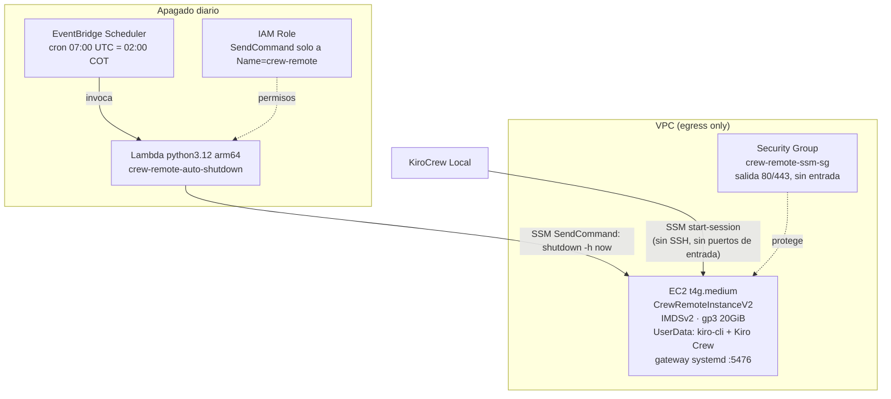

# kiro-remote-ssm

Instancia EC2 Graviton (t4g.medium, Amazon Linux 2023 ARM64) para Kiro Crew,
desplegada con CloudFormation + GitHub Actions (OIDC).
Acceso solo por SSM — sin SSH, sin puertos de entrada. Se apaga sola cada día.

El stack y sus recursos de AWS se llaman `crew-remote` (nombre lógico del
stack); este repositorio es `kiro-remote-ssm`.

## Arquitectura



## Componentes

| Recurso | Rol |
|---|---|
| **EC2 `CrewRemoteInstanceV2`** | Corre el gateway de Kiro Crew. Sin IP pública de entrada; solo egress. |
| **Security Group** | Solo salida (80/443). Sin puertos de entrada. |
| **UserData** | Instala kiro-cli + Kiro Crew y levanta el gateway como servicio systemd en el puerto 5476. Corre una sola vez, al primer arranque. |
| **Lambda `crew-remote-auto-shutdown`** | Python 3.12 ARM. Encuentra la instancia por tag `Name=crew-remote` y le manda `shutdown -h now` por SSM. |
| **EventBridge Scheduler** | Dispara la Lambda a diario, 07:00 UTC = 02:00 COT. Soporta zona horaria nativa (parámetro `ShutdownScheduleTimezone`). |
| **IAM role (Lambda)** | `SendCommand` limitado a la instancia con tag `Name=crew-remote`. |

## Flujo de acceso

No hay entrada por red. La conexión entra por el plano de SSM (salida HTTPS de
la instancia hacia AWS), así que el gateway nunca expone un puerto a internet.

## Post-deploy: conectar y activar

Tras un deploy exitoso, saca el `InstanceId` de las salidas del stack:

```bash
aws cloudformation describe-stacks --stack-name crew-remote \
  --region us-east-1 \
  --query "Stacks[0].Outputs[?OutputKey=='InstanceId'].OutputValue" --output text
```

Conéctate por SSM (sustituye `<INSTANCE_ID>` por el id anterior):

```bash
aws ssm start-session --target <INSTANCE_ID> --region us-east-1
```

Ya dentro (eres `ssm-user`), pásate a `ec2-user` y confirma que el bootstrap terminó:

```bash
sudo su - ec2-user
tail -n 40 /var/log/crew-bootstrap.log     # debe decir "bootstrap done"
```

Haz el login de kiro-cli. Es por navegador y no cabe en UserData, así que es el único paso manual. En una instancia headless usa device flow: imprime una URL y un código; ábrelos en el navegador de tu máquina:

```bash
kiro-cli login --use-device-flow
```

Reinicia el gateway ya autenticado y verifica que corre:

```bash
sudo systemctl restart kirocrew
sudo systemctl status kirocrew --no-pager
```

Por último, en KiroCrew Local: Settings → Remote Crew, pon el `InstanceId` y pulsa **Connect**.

## Operación

Ver todas las salidas del stack (instance id, SG, lambda, comando SSM):

```bash
aws cloudformation describe-stacks --stack-name crew-remote \
  --region us-east-1 --query 'Stacks[0].Outputs' --output table
```

Disparar el apagado manualmente (sin esperar al cron de las 02:00 COT):

```bash
aws lambda invoke --function-name crew-remote-auto-shutdown \
  --region us-east-1 /dev/stdout
```

Encender la instancia después de un apagado:

```bash
aws ec2 start-instances --instance-ids <INSTANCE_ID> --region us-east-1
```

Borrar el stack (p. ej. si quedó en `ROLLBACK_COMPLETE`, que no se puede re-desplegar):

```bash
aws cloudformation delete-stack --stack-name crew-remote --region us-east-1
aws cloudformation wait stack-delete-complete --stack-name crew-remote --region us-east-1
```

## Secreto de GitHub: `ROLE_ARN`

El workflow lee el ARN del rol desde un secreto, no del código. Créalo una vez:

**Por la web:** repo → Settings → Secrets and variables → Actions → New repository secret.

- Name: `ROLE_ARN`
- Secret: tu ARN real, con esta forma:

```text
arn:aws:iam::123456789012:role/github-oidc-provider-aws
```

**Por consola (`gh`):**

```bash
gh secret set ROLE_ARN --repo <tu-usuario>/kiro-remote-ssm \
  --body "arn:aws:iam::123456789012:role/github-oidc-provider-aws"
```

El `123456789012` es un valor dummy: cámbialo por tu account id real. Tu
account id real vive solo en este secreto, nunca en el código del repo.

## Desplegar

Automático al mergear a `main` (GitHub Actions), o manual:

```bash
aws cloudformation deploy \
  --template-file crew-remote.yaml \
  --stack-name crew-remote \
  --region us-east-1 \
  --capabilities CAPABILITY_NAMED_IAM
```

