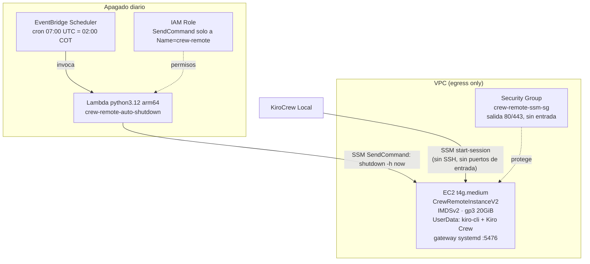

# kiro-remote-ssm

Instancia EC2 Graviton (t4g.medium, Amazon Linux 2023 ARM64) para Kiro Crew,
desplegada con CloudFormation + GitHub Actions (OIDC).
Acceso solo por SSM — sin SSH, sin puertos de entrada. Se apaga sola cada día.

El stack y sus recursos de AWS se llaman `crew-remote` (nombre lógico del
stack); este repositorio es `kiro-remote-ssm`.

## Arquitectura



## Componentes

| Recurso | Rol |
|---|---|
| **EC2 `CrewRemoteInstanceV2`** | Corre el gateway de Kiro Crew. Sin IP pública de entrada; solo egress. |
| **Security Group** | Solo salida (80/443). Sin puertos de entrada. |
| **UserData** | Instala kiro-cli + Kiro Crew y levanta el gateway como servicio systemd en el puerto 5476. Corre una sola vez, al primer arranque. |
| **Lambda `crew-remote-auto-shutdown`** | Python 3.12 ARM. Encuentra la instancia por tag `Name=crew-remote` y le manda `shutdown -h now` por SSM. |
| **EventBridge Scheduler** | Dispara la Lambda a diario, 07:00 UTC = 02:00 COT. Soporta zona horaria nativa (parámetro `ShutdownScheduleTimezone`). |
| **IAM role (Lambda)** | `SendCommand` limitado a la instancia con tag `Name=crew-remote`. |

## Flujo de acceso

No hay entrada por red. La conexión entra por el plano de SSM (salida HTTPS de
la instancia hacia AWS), así que el gateway nunca expone un puerto a internet.

## Post-deploy: conectar y activar

Tras un deploy exitoso, saca el `InstanceId` de las salidas del stack:

```bash
aws cloudformation describe-stacks --stack-name crew-remote \
  --region us-east-1 \
  --query "Stacks[0].Outputs[?OutputKey=='InstanceId'].OutputValue" --output text
```

Conéctate por SSM (sustituye `<INSTANCE_ID>` por el id anterior):

```bash
aws ssm start-session --target <INSTANCE_ID> --region us-east-1
```

Ya dentro (eres `ssm-user`), pásate a `ec2-user` y confirma que el bootstrap terminó:

```bash
sudo su - ec2-user
tail -n 40 /var/log/crew-bootstrap.log     # debe decir "bootstrap done"
```

Haz el login de kiro-cli. Es por navegador y no cabe en UserData, así que es el único paso manual. En una instancia headless usa device flow: imprime una URL y un código; ábrelos en el navegador de tu máquina:

```bash
kiro-cli login --use-device-flow
```

Reinicia el gateway ya autenticado y verifica que corre:

```bash
sudo systemctl restart kirocrew
sudo systemctl status kirocrew --no-pager
```

Por último, en KiroCrew Local: Settings → Remote Crew, pon el `InstanceId` y pulsa **Connect**.

## Operación

Ver todas las salidas del stack (instance id, SG, lambda, comando SSM):

```bash
aws cloudformation describe-stacks --stack-name crew-remote \
  --region us-east-1 --query 'Stacks[0].Outputs' --output table
```

Disparar el apagado manualmente (sin esperar al cron de las 02:00 COT):

```bash
aws lambda invoke --function-name crew-remote-auto-shutdown \
  --region us-east-1 /dev/stdout
```

Encender la instancia después de un apagado:

```bash
aws ec2 start-instances --instance-ids <INSTANCE_ID> --region us-east-1
```

### Dejar la instancia encendida 24/7 (desactivar el apagado diario)

El apagado automático lo dispara un schedule de EventBridge Scheduler
(`crew-remote-auto-shutdown`). Si quieres que la instancia no se apague, tienes
tres opciones, de la más temporal a la más permanente:

**1. Desactivar el schedule a mano (rápido, reversible).** Lo pone en `DISABLED`
sin tocar el stack. Ojo: un redeploy de CloudFormation lo vuelve a `ENABLED`.

```bash
# Desactivar (deja de apagar la instancia)
aws scheduler update-schedule --name crew-remote-auto-shutdown \
  --region us-east-1 --state DISABLED

# Volver a activar
aws scheduler update-schedule --name crew-remote-auto-shutdown \
  --region us-east-1 --state ENABLED
```

> El comando `update-schedule` exige reenviar el resto de la configuración del
> schedule. Si te da error por campos faltantes, es más cómodo usar la consola
> (EventBridge → Schedules → `crew-remote-auto-shutdown` → **Disable**) o la
> opción 2, que lo hace de forma declarativa.

**2. Desactivarlo de forma declarativa en el template (persistente).** Cambia el
estado del schedule a `DISABLED` en `crew-remote.yaml` y redespliega, así el
redeploy ya no lo reactiva:

```yaml
  ShutdownScheduler:
    Type: AWS::Scheduler::Schedule
    Properties:
      # ...
      State: DISABLED        # era ENABLED
```

**3. Ajustar el horario en vez de apagarlo del todo.** Si solo quieres correr el
apagado a otra hora o menos seguido, cambia el parámetro `ShutdownSchedule` (cron)
y, si quieres hora local, `ShutdownScheduleTimezone` (p. ej. `America/Bogota`) al
desplegar, sin tocar el template:

```bash
aws cloudformation deploy \
  --template-file crew-remote.yaml \
  --stack-name crew-remote \
  --region us-east-1 \
  --capabilities CAPABILITY_NAMED_IAM \
  --parameter-overrides ShutdownScheduleTimezone=America/Bogota \
                        ShutdownSchedule="cron(0 2 * * ? *)"
```

Recuerda que dejarla encendida 24/7 multiplica el costo de cómputo (ver abajo).

Borrar el stack (p. ej. si quedó en `ROLLBACK_COMPLETE`, que no se puede re-desplegar):

```bash
aws cloudformation delete-stack --stack-name crew-remote --region us-east-1
aws cloudformation wait stack-delete-complete --stack-name crew-remote --region us-east-1
```

## Secreto de GitHub: `ROLE_ARN`

El workflow lee el ARN del rol desde un secreto, no del código. Créalo una vez:

**Por la web:** repo → Settings → Secrets and variables → Actions → New repository secret.

- Name: `ROLE_ARN`
- Secret: tu ARN real, con esta forma:

```text
arn:aws:iam::123456789012:role/github-oidc-provider-aws
```

**Por consola (`gh`):**

```bash
gh secret set ROLE_ARN --repo <tu-usuario>/kiro-remote-ssm \
  --body "arn:aws:iam::123456789012:role/github-oidc-provider-aws"
```

El `123456789012` es un valor dummy: cámbialo por tu account id real. Tu
account id real vive solo en este secreto, nunca en el código del repo.

## Desplegar

Automático al mergear a `main` (GitHub Actions), o manual:

```bash
aws cloudformation deploy \
  --template-file crew-remote.yaml \
  --stack-name crew-remote \
  --region us-east-1 \
  --capabilities CAPABILITY_NAMED_IAM
```


## Costos mensuales aproximados

Estimación para **us-east-1**, precios on-demand bajo demanda leídos en
noviembre de 2026. Son aproximados y sirven de orden de magnitud; mira siempre
la [calculadora de AWS](https://calculator.aws/) y tu factura real, que varían
por región, uso de red y descuentos (Savings Plans, free tier de cuenta nueva).

### Qué compone el costo

| Recurso | Precio unitario (us-east-1) | Notas |
|---|---|---|
| **EC2 t4g.medium** | ~$0.0336 / hora | Solo se cobra mientras la instancia está **encendida**. Apagada (stopped) no genera costo de cómputo. |
| **EBS gp3 20 GiB** | $0.08 / GB-mes → **~$1.60 / mes** | Se cobra **siempre**, esté encendida o apagada, mientras el volumen exista. Incluye 3.000 IOPS y 125 MiB/s sin cargo extra. |
| **EventBridge Scheduler** | $1.00 / millón de invocaciones, tras 14M gratis/mes | 1 disparo diario ≈ 30/mes → **$0.00** (dentro del tramo gratis). |
| **Lambda (auto-shutdown)** | 1M requests + 400.000 GB-s gratis/mes | ~30 invocaciones de pocos segundos ARM → **$0.00**. |
| **AWS Systems Manager (SSM)** | Sin costo adicional | Session Manager y SendCommand sobre instancias EC2 estándar no tienen cargo. |
| **Transferencia de datos de salida** | Primeros 100 GB/mes gratis, luego ~$0.09/GB | El tráfico de control de Kiro Crew es bajo; normalmente **~$0**. |

El cómputo de EC2 es la única partida que escala con el uso. Todo lo demás
(Scheduler, Lambda, SSM) cae dentro del free tier para este patrón de uso, y el
EBS es un fijo de ~$1.60/mes.

### Escenarios

Tomando EC2 a $0.0336/h + EBS fijo ~$1.60/mes (730 h = 1 mes):

| Uso de la instancia | Horas EC2/mes | Cómputo EC2 | + EBS | **Total aprox./mes** |
|---|---|---|---|---|
| **2 h/día** (encender para trabajar, apagado diario hace el resto) | ~60 h | ~$2.02 | $1.60 | **~$3.6** |
| **8 h/día laborables** (~22 días) | ~176 h | ~$5.91 | $1.60 | **~$7.5** |
| **12 h/día todos los días** | ~365 h | ~$12.26 | $1.60 | **~$13.9** |
| **24/7** (apagado diario desactivado) | 730 h | ~$24.53 | $1.60 | **~$26.1** |

El apagado automático diario existe precisamente para mantenerte cerca de las
primeras filas: si olvidas apagar, el schedule la apaga de madrugada y evitas
pagar la instancia encendida sin usarla. Dejarla **24/7** (ver sección anterior)
es la opción más cara, ~$26/mes.

> **Reducir costo aún más:** si no vas a usarla por un tiempo largo, borra el
> stack (`aws cloudformation delete-stack`, ver arriba) para dejar de pagar
> también el EBS. Un Compute Savings Plan o una instancia reservada pueden
> bajar el precio del cómputo ~30–40% si el uso es constante.
